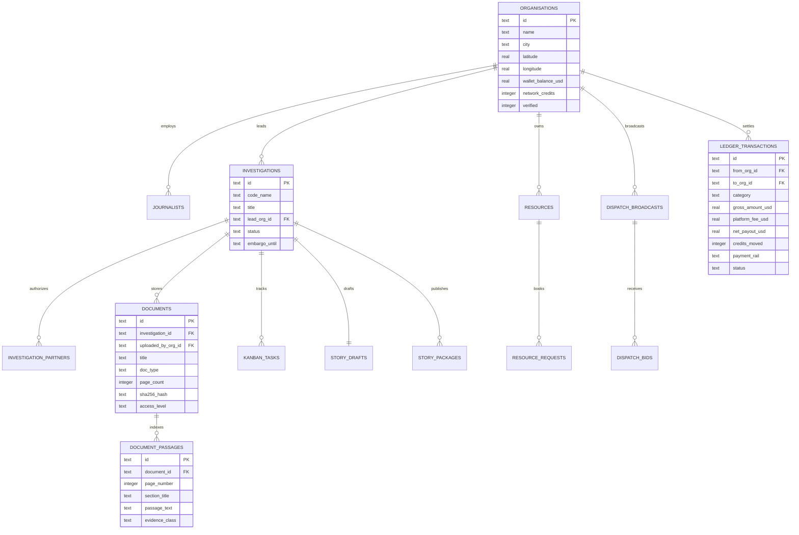

# Database Design — Connected Newsroom

Connected Newsroom uses **SQLite (`node:sqlite`)** stored at `data/connected_newsroom.sqlite` and initialized via [`database/schema.sql`](file:///home/malwande/School/Connected%20NewsRoom/database/schema.sql).

---

## 1. Entity-Relationship Diagram

---

## 2. Relational Table Catalogue (`database/schema.sql`)

| Table Name | Primary Key | Purpose & Key Columns |
| :--- | :--- | :--- |
| `organisations` | `id` (`TEXT`) | Stores media house profiles, GPS coordinates (`latitude`, `longitude`), `wallet_balance_usd`, `network_credits`, and `beats_json`. |
| `journalists` | `id` (`TEXT`) | Accredited specialist directory (`org_id`, `role`, `beats_json`, `languages_json`, `day_rate_usd`, `credit_rate`, `verified`). |
| `resources` | `id` (`TEXT`) | Equipment listings (`owner_org_id`, `category`, `serial_tag`, `daily_rate_usd`, `credit_cost`, `status`, `latitude`, `longitude`). |
| `dispatch_broadcasts` | `id` (`TEXT`) | Urgent *inDrive-style* field requests (`requester_org_id`, `needed_category`, `offered_rate_usd`, `radius_km`, `status`). |
| `dispatch_bids` | `id` (`TEXT`) | Counter-offers from nearby newsrooms/freelancers (`broadcast_id`, `bidder_org_id`, `proposed_rate_usd`, `eta_minutes`). |
| `resource_requests` | `id` (`TEXT`) | 4-stage booking lifecycle (`resource_id`, `requester_org_id`, `handover_pin`, `checkout_condition`, `return_condition`, `escrow_status`). |
| `investigations` | `id` (`TEXT`) | Private collaborative investigation repositories (`code_name`, `lead_org_id`, `embargo_until`, `status`). |
| `investigation_partners` | `(investigation_id, org_id)` | Cross-organisation ACL join table enforcing `HTTP 403` isolation against non-partner newsrooms. |
| `documents` | `id` (`TEXT`) | Uploaded PDFs, CSVs, scanned OCR images, and audio transcripts (`sha256_hash`, `page_count`, `access_level`). |
| `document_passages` | `id` (`TEXT`) | Page-indexed segments (`page_number`, `section_title`, `passage_text`, `evidence_class`: `Documented Evidence` vs. `Unverified Allegation`). |
| `kanban_tasks` | `id` (`TEXT`) | 5-stage verification tasks (`column_id`, `assigned_org_id`, `priority`, `evidence_ref`, `human_signed_off`, `signed_off_by`). |
| `story_drafts` | `id` (`TEXT`) | Pull-Request-style collaborative drafts tracking `gate_lead_editor_by`, `gate_partner_editor_by`, and `gate_legal_counsel_by`. |
| `story_packages` | `id` (`TEXT`) | Signed-off stories on the News Exchange Wire (`license_type`, `syndication_fee_usd`, `attribution_line`, `republish_count`). |
| `ledger_transactions` | `id` (`TEXT`) | Immutable financial & credit ledger tracking `gross_amount_usd`, `platform_fee_usd` (`5%`), `net_payout_usd` (`95%`), and `credits_moved` (`0%` fee). |
| `audit_logs` | `id` (`TEXT`) | Tamper-evident security log recording every AI query, document upload, ACL block, and sign-off event. |
