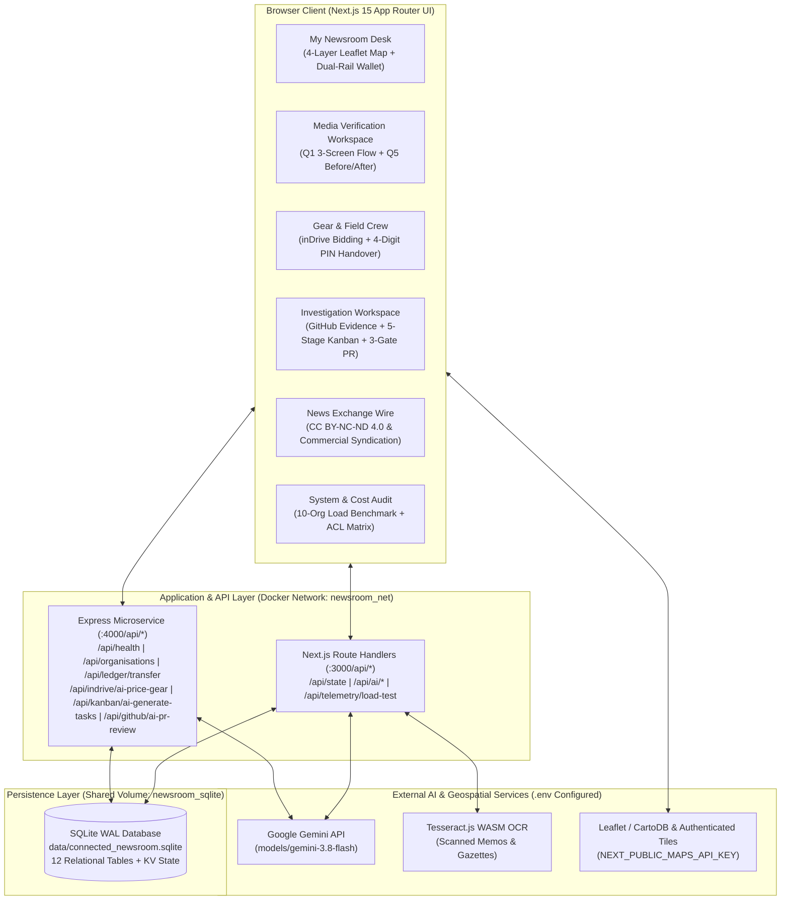

# System Architecture — Connected Newsroom

## 1. High-Level Architecture Diagram

---

## 2. Component Responsibilities

### 2.1 Frontend Presentation Layer (`src/components/*`)
- **[`GeographicMap.tsx`](file:///home/malwande/School/Connected%20NewsRoom/src/components/GeographicMap.tsx):** Dynamic client-side Leaflet map rendering 4 distinct geospatial layers across Zimbabwe (*Bulawayo*, *Harare*, *Mutare*):
  1. **🏛️ Newsroom Hubs** (`organisations`)
  2. **🎥 Shared Equipment** (`resources`, with 1-click booking modal trigger)
  3. **👤 Accredited Specialists** (`experts`, with 1-click collaboration invite trigger)
  4. **📡 Active Field Broadcasts** (`broadcasts`, with 28 km dashed dispatch radius circles)
- **[`MediaVerificationWorkspace.tsx`](file:///home/malwande/School/Connected%20NewsRoom/src/components/MediaVerificationWorkspace.tsx):** Dedicated 3-screen Misleading Headline vs. Official Audit verification workflow (Hackathon Q1) and interactive 1-Doc (*Before*) vs. 2-Doc (*After*) grounding comparison (Hackathon Q5).
- **[`InvestigationWorkspaceView.tsx`](file:///home/malwande/School/Connected%20NewsRoom/src/components/InvestigationWorkspaceView.tsx):** Combines the **Evidence Vault & OCR Uploader (`Step 1A`)**, **Grounded AI Research Copilot (`Step 1B`)**, **AI Audio Interview Transcriber (`Step 1C`)**, **5-Stage Verification Kanban Board (`Step 2`)**, and **3-Gate Pre-Publication Editorial & Legal Sign-Off (`Step 3`)**.
- **[`ResourceExchangeView.tsx`](file:///home/malwande/School/Connected%20NewsRoom/src/components/ResourceExchangeView.tsx):** Implements *inDrive for Journalism* — equipment listing with Gemini pricing suggestions, urgent field broadcasts, counter-offer negotiation, and 4-stage booking lifecycle (`Requested → Approved → Checked Out → Returned`).
- **[`NewsExchangeView.tsx`](file:///home/malwande/School/Connected%20NewsRoom/src/components/NewsExchangeView.tsx):** Syndication repository with full-text reader, provenance verification badges, attribution generator, and revenue-split settlement.
- **[`SecurityAuditView.tsx`](file:///home/malwande/School/Connected%20NewsRoom/src/components/SecurityAuditView.tsx):** Displays the cross-organisation ACL matrix, live resource cost breakdown, and interactive **10-Organisation (50-User) Concurrent Load Test Runner**.

### 2.2 Backend & Persistence Layer (`src/lib/db.ts` & `backend/server.mjs`)
- Uses Node's built-in `node:sqlite` (`DatabaseSync`) writing to `data/connected_newsroom.sqlite` on a shared Docker volume (`newsroom_sqlite`).
- Executes [`database/schema.sql`](file:///home/malwande/School/Connected%20NewsRoom/database/schema.sql) automatically on boot to provision 12 relational tables alongside atomic JSON document collections.

### 2.3 Responsible AI Architecture (`gemini-3.8-flash`)
- **Zero Uncited Extrapolation:** Every prompt to `gemini-3.8-flash` injects only the ACL-authorized document passages (`organisation_id` + `investigation_id` check) and requires structured JSON output containing `exactQuote`, `pageNumber`, `sectionTitle`, and `classification` (`Documented Evidence` vs. `Unverified Allegation`).
- **Graceful Deterministic Fallback:** If the newsroom loses internet connectivity in the field, all AI endpoints fall back deterministically to local passage-ranking and citation extraction so field reporting never halts.
